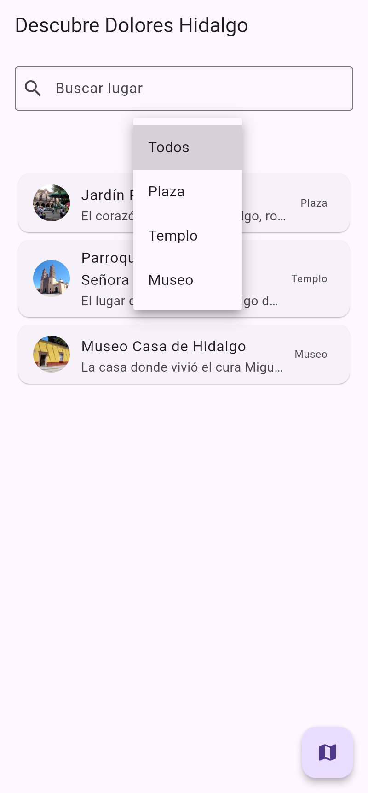
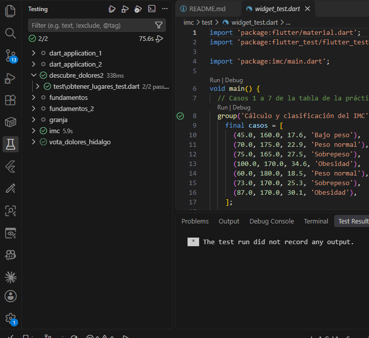

# Descubre Dolores Hidalgo

Aplicación móvil hecha en Flutter que funciona como guía turística de Dolores Hidalgo, Guanajuato. Muestra una lista de lugares emblemáticos, permite buscarlos y filtrarlos por categoría, y ofrece una ficha de detalle con imagen, descripción, audioguía y, en el caso de la parroquia, un video.

**Autor:** Jonathan Venancio Aguilar Hernandez

## 1. Descripción breve

La pantalla principal carga los lugares y los presenta en tarjetas con su foto, nombre, un resumen y la categoría. Un campo de búsqueda filtra por nombre mientras se escribe, y un menú desplegable filtra por categoría (Todos, Plaza, Templo y Museo). Ambos filtros se combinan.

Al tocar una tarjeta se abre el detalle del lugar: imagen, descripción completa y un botón para escuchar o pausar la audioguía. La Parroquia de Nuestra Señora de los Dolores incluye además un reproductor de video. El botón flotante del mapa muestra por ahora el aviso "Próximamente: mapa de lugares".

## 2. Lugares incluidos

| Lugar | Categoría | Multimedia |
|-------|-----------|------------|
| Jardín Principal | Plaza | Imagen y audioguía |
| Parroquia de Nuestra Señora de los Dolores | Templo | Imagen, audioguía y video |
| Museo Casa de Hidalgo | Museo | Imagen y audioguía |

## 3. Arquitectura

El proyecto sigue una arquitectura limpia de tres capas. Cada capa solo conoce a la que tiene debajo, y las dependencias concretas se arman en un único lugar, el archivo `main.dart`.

| Capa | Carpeta | Responsabilidad |
|------|---------|-----------------|
| Dominio | `lib/domain` | Entidad `LugarTuristico`, contrato `LugaresRepository` y casos de uso `ObtenerLugares` y `ObtenerLugarPorId` |
| Datos | `lib/data` | `LugaresLocalDataSource` (los lugares están definidos en código) y `LugaresRepositoryImpl` |
| Presentación | `lib/presentation` | ViewModels con `ChangeNotifier` y las pantallas de lista y de detalle |

**Manejo de estado:** cada pantalla tiene su ViewModel (`LugaresViewModel` y `DetalleViewModel`), que extiende `ChangeNotifier`. Las vistas se reconstruyen con `AnimatedBuilder` cada vez que el ViewModel llama a `notifyListeners()`, sin paquetes externos de estado.

## 4. Estructura del código

```
descubre_dolores/
├── lib/
│   ├── main.dart                      # Composición de dependencias
│   ├── domain/
│   │   ├── entities/lugar_turistico.dart
│   │   ├── repositories/lugares_repository.dart
│   │   └── usecases/
│   │       ├── obtener_lugares.dart
│   │       └── obtener_lugar_por_id.dart
│   ├── data/
│   │   ├── datasources/lugares_local_datasource.dart
│   │   └── repositories/lugares_repository_impl.dart
│   └── presentation/
│       ├── viewmodels/
│       │   ├── lugares_view_model.dart
│       │   └── detalle_view_model.dart
│       └── views/
│           ├── lista_lugares_screen.dart
│           └── detalle_lugar_screen.dart
├── assets/
│   ├── images/                        # Fotos de los lugares
│   ├── audio/                         # Audioguías (.mp3)
│   ├── video/                         # Video de la parroquia
│   └── CREDITOS.txt                   # Autoría de la multimedia
├── test/
│   └── obtener_lugares_test.dart
├── capturas/                          # Screenshots usados en este README
└── pubspec.yaml
```

## 5. Dependencias

| Paquete | Uso |
|---------|-----|
| `audioplayers` | Reproducción de la audioguía |
| `video_player` | Reproducción del video de la parroquia |

Si el archivo de audio de un lugar no está en `assets/audio/`, la app no falla: muestra el aviso "Audioguía no disponible" debajo del botón.

## 6. Cómo ejecutar la app

Requisitos: Flutter 3 o superior (Dart 3.13).

```bash
# 1) Dependencias
flutter pub get

# 2) Ejecutar en emulador o dispositivo físico
flutter run
```

## 7. Screenshots

### Lista de lugares


### Búsqueda por nombre


### Filtro por categorías



### Resultado filtrado por Templo


### Detalle de la parroquia


### Botón del mapa


### Detalle del Jardín Principal


## 8. Pruebas (`flutter test`)

```bash
flutter test
```

Resultado de la ejecución en Visual Studio Code:



Las pruebas están en `test/obtener_lugares_test.dart` y usan un repositorio falso (`FakeLugaresRepository`) para probar la capa de dominio sin depender de la capa de datos:

| Prueba | Qué comprueba |
|--------|---------------|
| `ObtenerLugares` | Devuelve la lista que entrega el repositorio |
| `ObtenerLugarPorId` | Devuelve el lugar si el id existe y `null` si no existe |

## 9. Créditos de multimedia

Las imágenes y el video provienen de Wikimedia Commons. El detalle de autoría y licencias (CC BY-SA 4.0 y CC0) está en [`assets/CREDITOS.txt`](assets/CREDITOS.txt).
